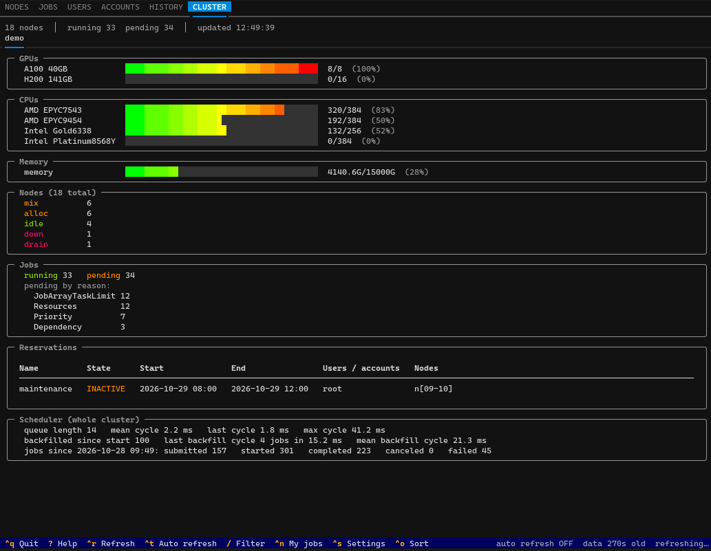
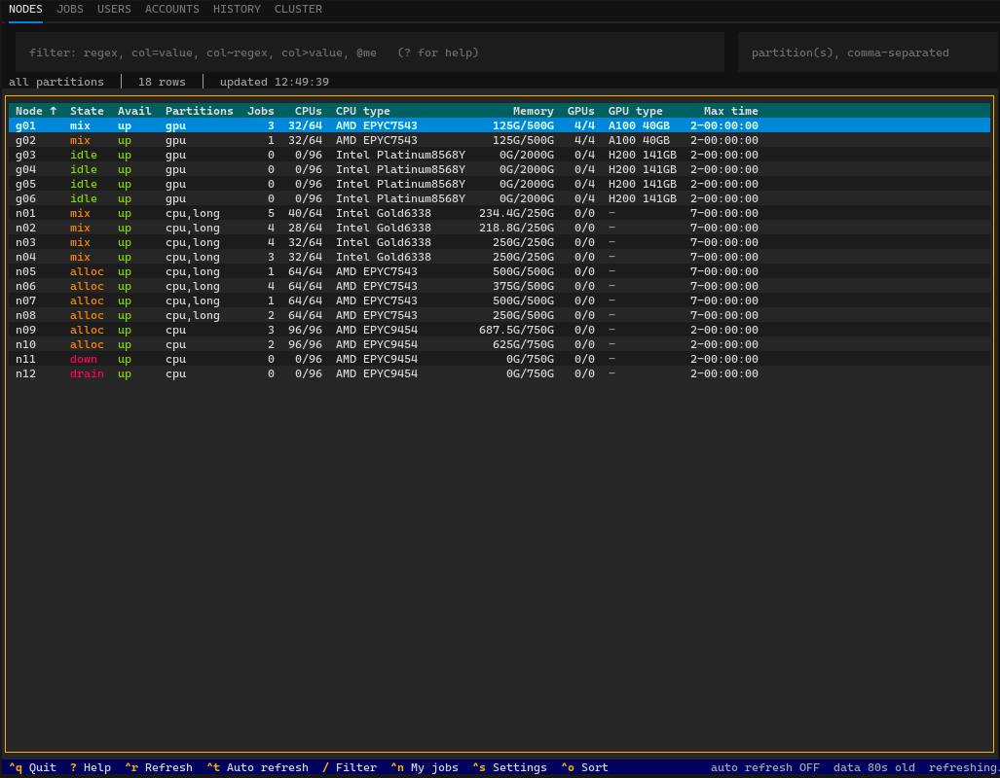
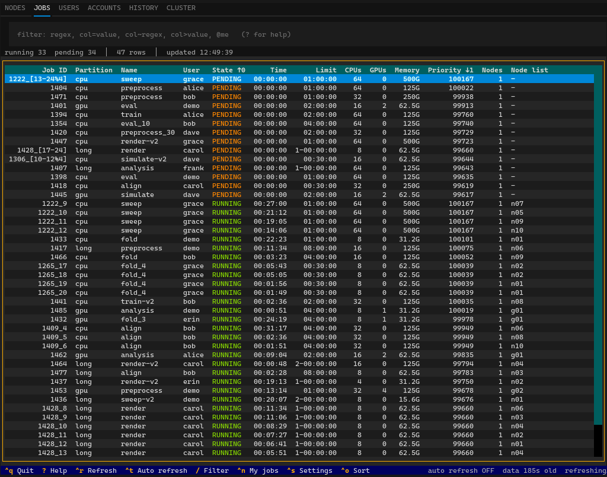

# slurmtui

A terminal user interface for monitoring [Slurm](https://slurm.schedmd.com/) clusters: nodes, jobs, users, accounts, your job history and a cluster overview.



*The CLUSTER tab of the demo cluster: usage per GPU and CPU type, node states, pending reasons, reservations and scheduler statistics. Every screenshot here is `slurmtui --demo`.*

- Node groups, hardware labels, columns and colours live in a site config. Labels come from rules over node features and GRES types (`A100 40GB`, `Intel Gold6338`), groups from node and partition patterns. The CLUSTER subtabs and the CPU/GPU-hour columns per group follow from them.
- Every view shares cached data to minimize the load on Slurm. The two expensive accounting sweeps that load slurmdbd are opt-in and off by default.
- Each data source has its own refresh interval, inactive tabs refresh less often, and a slow `sacct` never blocks the other tabs. After a failed fetch the previous data stays on screen with the error in the status line.
- Typed columns. Memory, durations, timestamps and percentages are parsed, so `mem>64G` filters and `117.2G` sorts after `64G`. Unlimited and missing values sort last.
- One filter grammar everywhere. Free regex over the row, `column=value`, `column~regex`, `column>value` and `@me` for your own jobs. Several terms are ANDed.
- Strict configuration. Unknown keys and bad values are reported with their key path and the file that set them, and `slurmtui check-config` prints the effective configuration. Changes made in the settings screen go to a separate state file, your TOML is never rewritten.
- Job output on screen. The detail screens tail stdout with sbatch patterns such as `%j` and `%x` resolved, ANSI stripped and progress bars collapsed to their last state.
- `slurmtui --demo` simulates a small cluster whose jobs arrive, start and finish while you watch, with its own configuration.
- Text output of the standard CLI tools only (`scontrol`, `squeue`, `sshare`, `sdiag`, `sacct`, `seff`), never through a shell. See [What slurmtui assumes about Slurm](#what-slurmtui-assumes-about-slurm).
- Two dependencies, Textual and pydantic, and Python 3.12 or newer. Everything below the UI is typed and tested on real command output.
- Admin actions (drain, resume, `scontrol update`), job submission, the JSON and REST interfaces of Slurm, and federated or multi-cluster views are out of scope for now.

## Installation

Python 3.12 or newer, on a node where the Slurm client tools are available.

```bash
pip install .            # from this directory
slurmtui                 # or: python -m slurmtui
slurmtui --demo          # try it without Slurm: a small simulated cluster
```

## Tabs

| Tab | Shows | Details on Enter |
| --- | --- | --- |
| NODES | one row per node: compact state (`idle~`, `mix`, `drng`), partition availability, running jobs, CPUs, CPU type, memory, GPUs, GPU type, max walltime. A partition input restricts the rows and lists the nodes the filter excluded. | drain reason, jobs on the node by user, `scontrol show node`; *Show in JOBS* |
| JOBS | the queue with typed columns (durations, memory, GPUs from TRES). `ctrl+n` toggles your own jobs. | `scontrol show job`, tail of stdout; Hold / Release / Cancel for your own jobs |
| USERS | every user with jobs: running/pending counts, allocated CPUs/GPUs/memory, nodes, partitions, fairshare | jobs of the user by partition, share rows; *Show in JOBS* |
| ACCOUNTS | every account: shares, usage, LevelFS, live footprint, active members, oldest pending job and, when enabled, CPU/GPU hours per node group over a configurable window | jobs of the account by user, fairshare by user; *Show in JOBS* |
| HISTORY | your job history from `sacct` with memory and CPU efficiency | `seff` summary, tail of stdout (sbatch patterns such as `%j` and `%x` in the output path are resolved) |
| CLUSTER | one subtab per node group: usage bars per GPU and CPU type, memory, node states, jobs and pending reasons, reservations, scheduler statistics | |



*NODES: states in sinfo colours, CPUs, memory and GPUs as used/total, hardware labels derived from the node features. The input on the right restricts the rows to one or more partitions.*

## Keys

| Key | Action |
| --- | --- |
| `ctrl+q` | quit |
| `?` | help: keys, filter grammar, column keys of the current tab |
| `ctrl+r`, `F5` | refresh the active tab |
| `ctrl+t` | toggle auto refresh |
| `/` | focus the filter, `Esc` leaves it, `ctrl+l` clears it |
| `ctrl+left` / `ctrl+right` | previous / next tab |
| `ctrl+n` | toggle `@me` in the JOBS filter |
| `ctrl+z` | JOBS: back to the filter replaced by *Show in JOBS* (`Esc` on the table does the same) |
| `ctrl+o` | sort dialog |
| `ctrl+s` | settings: theme, units, auto refresh, columns and sorting per tab |
| `Enter` | details of the selected row |

All keys are configurable under `[keys]` in the user config. The node, user and account details have a *Show in JOBS* button that opens the JOBS tab with the matching filter (`node_list=gpu001`, `user=alice`, `account=foo`); `ctrl+z` brings the previous filter back.

## Filtering and sorting

The filter bar takes space-separated terms that must all match:

```
gpu                      regex over the visible row
user=alice,bob           equality on a column (case-insensitive)
partition~^cloud         regex on a column; != and !~ negate
mem>64G time>2h          typed comparisons: numbers, memory, durations, dates, percentages
@me                      your jobs
```

Click a column header to sort (ascending, descending, off; the clicked column becomes the primary key), or type `state desc, name` into the sort dialog. Sorting works on the typed values, so `117.2G` sorts after `64G` and unlimited time limits sort last.



*JOBS sorted by `state, priority desc`: the header marks the sort keys and their order. `ctrl+n` narrows the list to your own jobs, Enter opens the job detail with the tail of its output.*

## Configuration

Three TOML layers: packaged defaults, a site file (`/etc/slurmtui/config.toml` or `$SLURMTUI_SITE_CONFIG`) and a user file (`~/.config/slurmtui/config.toml`). Runtime changes made in the settings screen go to a separate state file; the app never rewrites your TOML.

```bash
slurmtui check-config                 # which files were loaded, effective configuration, or errors
slurmtui dump-config --defaults       # the packaged defaults as a starting point
slurmtui columns [tab]                # available column keys
```

The essential site settings:

```toml
[[node_groups]]                       # one CLUSTER subtab and one pair of usage columns each
name = "on-prem"
nodes = ["node*"]
partitions = ["re:^(?!cloud)"]

[[node_groups]]
name = "cloud"
nodes = ["cloud*"]
partitions = ["cloud*"]

[hardware.gpu_type]                   # label rules over GRES types and feature tokens
rules = [{ feature = "re:^([A-Z0-9-]+?)-(\\d+GB)$", label = "{feature.1} {feature.2}" }]
fallback = "{gres_type}"

[sources]                             # the expensive slurmdbd sweeps, off by default
account_usage = { enabled = true, ttl = 900, default_window = "7d", max_window = "14d" }
```

See [docs/configuration.md](docs/configuration.md) for the full reference, [docs/columns.md](docs/columns.md) for the column keys and [examples/demo/](examples/demo/) for a complete site file and a user file, both written for the demo cluster.

## Demo mode

`slurmtui --demo` needs no Slurm. It runs an in-memory model of a small cluster (12 compute nodes of three CPU generations, 6 GPU nodes with A100s and H200s, three partitions, eight users in three accounts) whose queue moves with the wall clock: jobs arrive every minute or so, start when resources free up and finish as COMPLETED, FAILED, TIMEOUT or OUT_OF_MEMORY; arrays, dependencies and held jobs occur, and Hold / Release / Cancel act on the model. On every refresh the model is rendered as the text `scontrol`, `squeue`, `sshare`, `sdiag` and `sacct` would print and goes through the normal parsers, so the demo exercises the same code as a real cluster.

The demo uses its own site configuration, `examples/demo/site-config.toml`, instead of `/etc/slurmtui/config.toml` and `~/.config/slurmtui/config.toml`; a copy ships inside the package, so `slurmtui --demo` works after `pip install` without a checkout (`slurmtui --demo check-config` prints it). It keeps its settings in a separate state file and turns auto refresh on. The usual overrides apply, so the example user file and an edited site file can be tried on the demo:

```bash
slurmtui --demo --config examples/demo/user-config.toml
slurmtui --demo --site-config examples/demo/site-config.toml   # after editing the example
```

## What slurmtui assumes about Slurm

slurmtui parses the text output of the Slurm client tools. It was developed against
Slurm 24.11; any release whose `squeue -O` accepts the field names in
`src/slurmtui/slurm/commands.py` should work. Site differences it depends on:

- **Client tools.** `scontrol`, `squeue`, `sshare`, `sdiag` and `sacct` must be on `PATH`
  (or under `[commands].path_prefix`) on the host where slurmtui runs. `seff` is optional;
  without it the HISTORY detail has no efficiency summary.
- **Accounting database.** HISTORY, the usage and fairshare columns of USERS and the whole
  ACCOUNTS tab come from `sacct` and `sshare`, so they need slurmdbd. Without it those views
  stay empty and the status line shows the error; NODES, JOBS and CLUSTER keep working.
  `PrivateData` settings that hide other users' jobs or usage hide them here too.
- **GPUs are the GRES named `gpu`.** Other GRES (`shard`, `mps`, FPGAs) are not shown.
  Totals come from `CfgTRES` or the node's `Gres` string. Allocated GPUs come from
  `AllocTRES` when `AccountingStorageTRES` includes `gres/gpu`; otherwise node allocations
  fall back to `GresUsed` (`scontrol -d`) and job allocations to the request (`--gpus`,
  `--gres`, `--gpus-per-node`, `--gpus-per-task`). GPU hours on the ACCOUNTS tab are the only
  numbers with no fallback: they are 0 unless `gres/gpu` is tracked. Per-type GPU bars need
  typed GRES (`gres/gpu:a100`).
- **Environment.** The commands run with `LC_ALL=C`, `SLURM_TIME_FORMAT=standard` and
  `SLURM_BITSTR_LEN=0`, and without the `SQUEUE_*`, `SACCT_*`, `SCONTROL_*` and `SSHARE_*`
  defaults from your shell (they would silently filter or reformat the output). `SLURM_CONF`,
  `SLURM_CLUSTERS` and everything else are inherited; `[commands].env` is applied last.
  Federations and multi-cluster views are not supported.
- **Identity.** "Your" jobs (`@me`, HISTORY, the Hold/Release/Cancel buttons) are those of
  the login name from the environment (`getpass.getuser()`), which is also what Slurm uses
  unless you run slurmtui under `sudo`.
- **Timestamps** are read as local time of the host running slurmtui, the same clock the
  Slurm tools print them in. MaxRSS printed without a unit is taken as bytes
  (`sacct --noconvert` on current releases); `[sources.history].max_rss_unit` overrides this
  for sites whose sacct prints kilobytes. `ReqMem` with the old `c`/`n` suffixes is
  understood.
- **Partitions.** Only partitions visible to the user are considered: the `avail` and
  `max_time` columns of a node look at its visible partitions, and `avail` is `down` when any
  of them is not `UP`. Hidden partitions do not appear in the partition input.
- **Field widths.** `squeue -O` truncates a value longer than its configured width (job names
  at 200 characters, node lists at 1500, paths at 400). Values are separated by a tab, so a tab
  inside a job name or path breaks that row.

## Development

```bash
pip install -e '.[dev]'
pytest                       # unit, app and performance tests on generated command outputs
                             # (tests/fixtures/hybrid-cloud; no golden screenshots)
ruff check src tests && ruff format --check src tests
mypy src                     # strict below the UI, check-untyped-defs in slurmtui.ui
python tools/gen_docs.py     # regenerate docs/*.md and the packaged copy of examples/demo/site-config.toml
python tools/make_test_fixtures.py   # regenerate the test cluster (a hybrid on-premise/cloud site)
```

Architecture: `config` (pydantic schema, layered loading, state) → `slurm` (backend protocol, CLI, text and simulated backends, parsers) → `model` (typed records, derivation rules) → `data` (TTL cache with in-flight deduplication, aggregations) → `columns` (registry, formatting, sorting, filtering) → `ui` (Textual tabs and screens). Nothing above the backend runs a subprocess; nothing below the UI imports Textual.

For a bug report, run with `--log-level debug --log-file slurmtui.log` and attach the log; for a parsing problem, add the offending line of command output (`squeue -O ...` as listed in `src/slurmtui/slurm/commands.py`, `scontrol -d -o show node`, ...).

## License

MIT, see [LICENSE](LICENSE).
